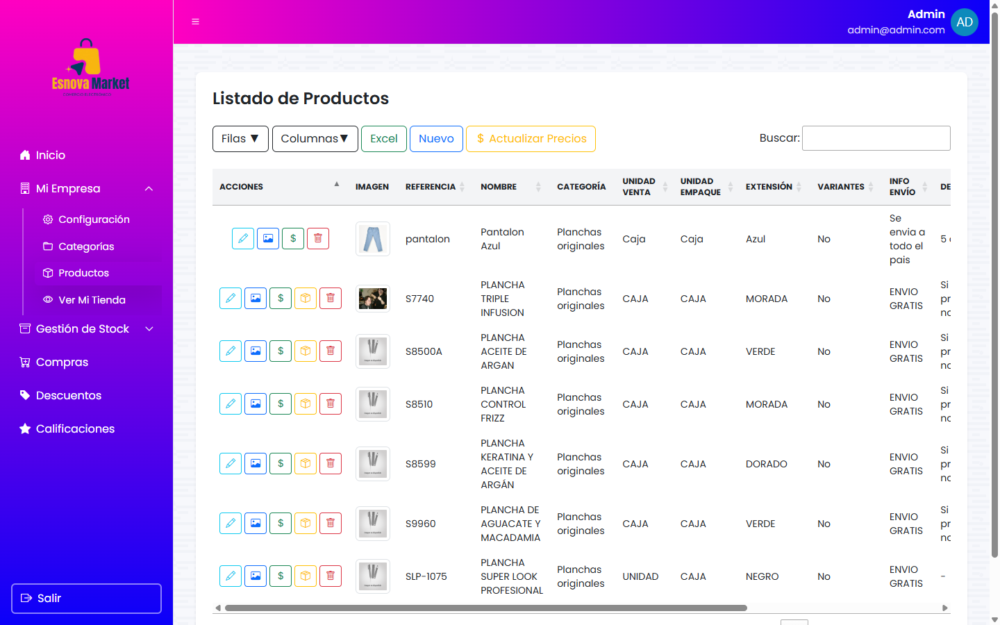
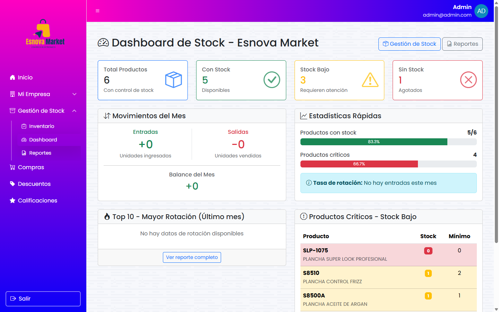
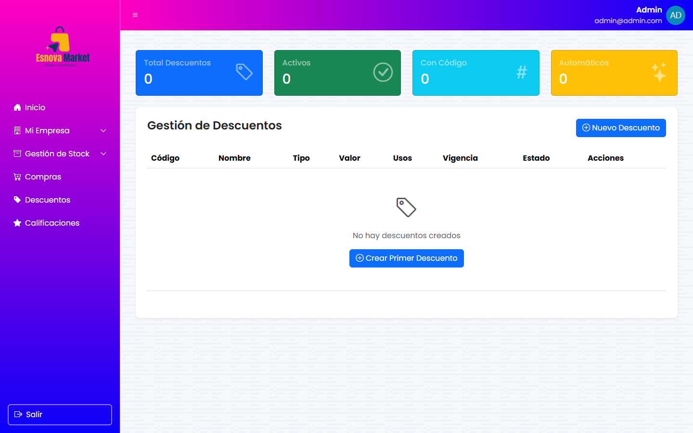

# Esnova Market — E-commerce multiempresa con pasarela de pagos

Plataforma de comercio electrónico donde cada empresa tiene su propia tienda, catálogo y stock, con membresías pagadas por pasarela (Wompi).


## Contexto

El proyecto nació como tienda en línea de productos para el cuidado del cabello y evolucionó a una plataforma donde varias empresas pueden publicar su tienda pagando un plan de membresía, con comisiones para la plataforma.

## Funcionalidades

- **Tienda pública** con buscador, categorías, carrito de compras, registro de clientes y calificaciones de productos.
- **Pasarela de pagos Wompi** para membresías y compras, con webhook de confirmación y log de transacciones.
- **Multiempresa:** cada empresa configura su tienda, plantilla visual, logo, portada y SEO (Open Graph / Twitter cards).
- **Planes de membresía y comisiones** para la plataforma.
- **Catálogo:** productos con variantes, características, listas de precios e imágenes múltiples; actualización masiva de precios por Excel.
- **Gestión de stock** con dashboard, movimientos de entrada/salida, productos críticos y reporte de rotación.
- **Descuentos** automáticos o con código y gestión de compras/envíos.

## Stack

- **Backend:** PHP 8, Laravel 9, MySQL/MariaDB
- **Autenticación y permisos:** Laravel Breeze + spatie/laravel-permission (roles y permisos)
- **Frontend:** Blade, Livewire, Alpine.js, Tailwind CSS, Bootstrap, DataTables, SweetAlert2
- **Pagos:** Wompi (Bancolombia)

## Capturas

**Administración de productos**



**Dashboard de stock**



**Gestión de descuentos**



## Instalación local

Requisitos: PHP 8.0+ (con extensiones `gd`, `zip`, `intl`), Composer, Node 18+ y MySQL/MariaDB.

```bash
git clone <url-del-repositorio>
cd esnova
composer install
npm install && npm run build
cp .env.example .env        # configura la conexión a la base de datos
php artisan key:generate
php artisan migrate --seed
php artisan serve
```

La aplicación queda disponible en `http://localhost:8000`. Los seeders crean los roles y datos iniciales (revisa `database/seeders`).

## Notas

- Proyecto desarrollado para un cliente real y desplegado en producción. Las capturas se tomaron en un entorno local; el historial de este repositorio se depuró para no incluir credenciales ni copias de bases de datos.

## Autor

**Santiago Bellaizán** — Desarrollador Full Stack (Laravel · PHP · MySQL · JavaScript)

- GitHub: [@Santibc](https://github.com/Santibc)
